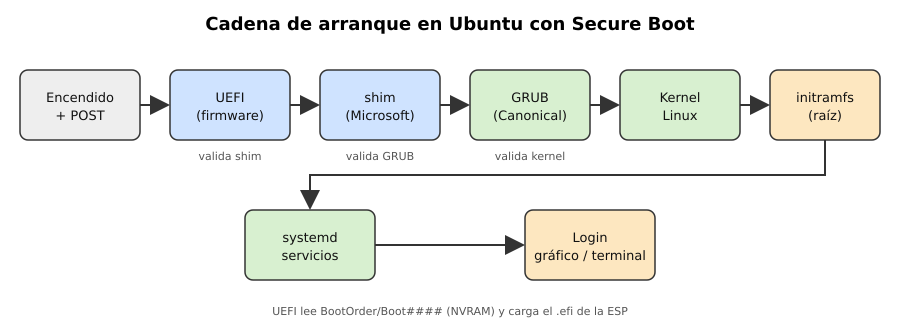
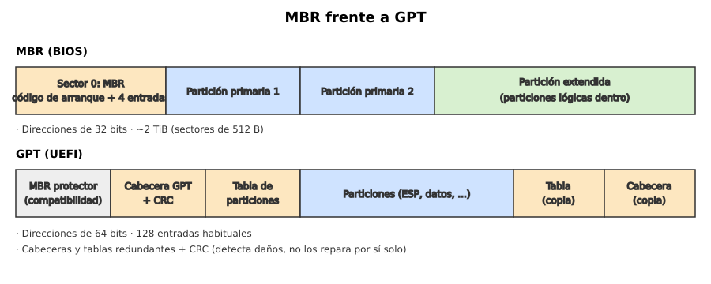
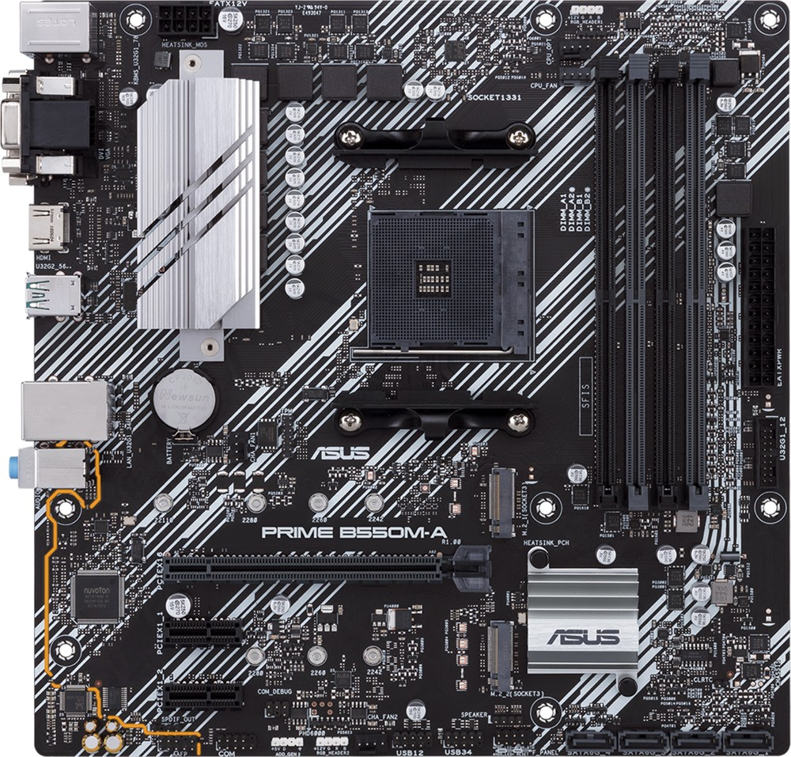

# Puzzle UT2 · Pieza NN: Nombre de la pieza

**Grupo:** David Martinez do Nascimento (@davidengranada) · Nombre Apellido (@usuario)
:wq

## 1. Qué es y qué función cumple en el sistema

El firmware es el primer software que inicia el funcionamiento del equipo al encenderlo. En un PC se almacena normalmente en memoria flash de la placa base, que conserva su contenido sin alimentación; inicializa el hardware y prepara la ejecución del gestor de arranque, que cargará el sistema operativo.

Hay dos generaciones principales:

- **BIOS heredada:** asociada al IBM PC de 1981; su entorno tradicional de arranque utiliza modo real 16 bits, con un espacio de direcciones de 1 MiB. Esto no significa que el sistema quede limitado a esa memoria.
- **UEFI:** interfaz estandarizada sucesora de la BIOS tradicional, con implementaciones de 32 o 64 bits; en los PC x86-64 modernos lo habitual es una implementación de 64 bits ([UEFI Forum](https://uefi.org/specifications))

UEFI permite servicios de arranque, controladores y aplicaciones previas al sistema operativo; no exige que el menú de configuración sea gráfico. Una cadena de Ubuntu, con Secure Boot activo, es `Encendido → inicialización y POST → shim → GRUB → kernel e initramfs → systemd → login` ([Ubuntu](https://documentation.ubuntu.com/security/security-features/plataform-protections/secure-boot/)).

## 2. Cómo funciona por dentro




### Encendido y POST

La fuente estabilizada la alimentación y la CPU comienza a ejecutar el firmware desde una dirección de inicio definida por la arquitectura. El firmware inicia el componentes y realiza comprobaciones, conocidas como POST, sobre elementos comos la memoria y los dispositivos necesarios para arrancar.

Los avisos dependen de la placa: pueden ser pitidos, LEDs o códigos en un display. No todos los equipos emiten un pitidos de éxito  ni llevan altavoz; los códigos deben consultarse en el manual del modelo.

### Ajustes y búsquedas del arranque

La pila de botón mantiene principalmente el reloj en tiempo y, en diseños tradicionales, la memoria CMOS. En equipos UEFI muchos ajustes y variables de arranque de aguardan en almacenamiento no volátil, por lo que no es correcto afirmar que todos dependen de la pila; Ubuntu utiliza NVRAM como `Boot0order` y `Boot###` para selecionar el arranque([Ubuntu](https://documentation.ubuntu.com/security/security-features/plataform-protections/secure-boot)).

En el arranque BIOS clásico se ejecuta código del primer sector del dispositivo. UEFI puede cargar un archivo `.efi` desde la partición del sistema EFI o ESP, habitualmente FAT32 en discos de PC; además de las entradas NVRAM, existe una ruta reserva, como `\EFI\BOOT\BOOTX64.EFI`para x86-64 ([UEFI Forum](https://uefi.org/specifications)).

### Seguirdad y traspaso al sistema

Secure Boot comprueba los ejecutables de arranque según una política de confianza: `db` contiene autorizada y `dbx`, revocaciones. No garantiza por sí solo que el sistema esté libre de todo malware ([UEFI Forum](https://uefi.org/specifications)).

Ubuntu proporciona `shim` firmado por Microsoft y GRUB firmado por Canonical; el firmware valida `shim`, este valida GRUB y GRUB comprueba el kernel firmado. El kernel también exige firmas válidas a los módulos externos cuando corresponde, pero no debe afirmarse que todos los archivos del arranque tradicional quedan verificados: la documentación señala que el `initrd` de esa cadena no se valida ([Ubuntu](https://documentation.ubuntu.com/security/security-features/platform-protections/secure-boot/)).

El TPM es un componente criptográfico, que puede ser discreto o implementado mediante firmware. En Measured Boot, los componentes de la cadena de arranque calculan medidas y las extienden en registros PCR del TPM; una política puede condicionar la liberación de una clave a esos valores, pero requiere configuración y no se activa automáticamente por instalar Ubuntu.

Finalmente, el kernel inicializa sus controladores y utiliza normalmente un entorno `initramfs` para preparar el acceso a la raíz. Después arranca `systemd`, que organiza servicios y sesiones, hasta llegar al acceso gráfico o por terminal.

## 3. Características, unidades y cómo se miden


Los valores siguientes son orientativos: no constituyen requisitos universales. La capacidad flash, el tiempo de POST y el tamaño de la ESP dependen del equipo y de la instalación.

| Característica | Unidad | Referencia orientativa | Interpretación |
|---|---|---|---|
| Capacidad flash | Mbit / MB | 128–256 Mbit en muchas placas | 256 Mbit equivalen a 32 MB; no confundir bits y bytes |
| Entorno de ejecución | bits | BIOS tradicional: 16; UEFI x86-64: 64 | Describe el entorno del firmware, no toda la capacidad de la CPU |
| Memoria direccionable | MiB / GiB | BIOS en modo real: 1 MiB | UEFI de 64 bits supera ese límite, pero tiene límites de arquitectura e implementación |
| Capacidad con MBR | TiB | Aproximadamente 2 TiB con sectores lógicos de 512 bytes | El límite cambia con el tamaño del sector lógico |
| Particiones GPT | número | 128 entradas en muchas instalaciones | No es un máximo universal del formato |
| Tiempo del firmware | segundos | Desde pocos segundos hasta bastante más | Influyen entrenamiento de RAM, dispositivos y configuración |
| Pila del reloj | V | CR2032 de 3 V, habitual en sobremesa | Comprobar el repuesto en el manual |
| ESP | MiB | Cientos de MiB; tamaño variable | Debe alojar los cargadores y dejar espacio para actualizaciones |

La tabla de particiones, la ESP y las estructuras GPT se definen en la especificación UEFI; no deben confundirse con las características físicas del chip de firmware ([UEFI Forum](https://uefi.org/specifications)).

Para consultar un equipo Linux pueden utilizarse estos comandos; algunos requieren permisos de administrador o instalar su paquete:

```bash
sudo dmidecode -t bios
[ -d /sys/firmware/efi ] && echo UEFI || echo "Sin interfaz EFI detectada"
mokutil --sb-state
sudo fdisk -l
lsblk -o NAME,SIZE,FSTYPE,PARTTYPE,MOUNTPOINTS
sudo efibootmgr -v
```

`dmidecode` muestra los datos que declara el firmware; la existencia de `/sys/firmware/efi` indica normalmente un arranque UEFI. `fdisk` informa de la tabla de particiones, mientras `lsblk` ayuda a identificar sistemas de archivos y tipos de partición; `lsblk -f`, por sí solo, no determina con claridad MBR frente a GPT.

`mokutil` permite consultar el estado de Secure Boot y gestionar determinadas operaciones MOK, pero no firma por sí mismo todos los módulos. Las claves MOK permiten autorizar módulos de terceros mediante el proceso de inscripción correspondiente ([Ubuntu](https://documentation.ubuntu.com/security/security-features/platform-protections/secure-boot/)).

## 4. Tipos, evolución y estándares actuales



| Aspecto | BIOS heredada | UEFI |
|---|---|---|
| Arranque habitual | Código en sectores de arranque | Aplicaciones y cargadores `.efi` |
| Configuración | Frecuentemente texto y teclado | Puede ser gráfica o textual |
| Particionado habitual | MBR, aunque BIOS puede arrancar GPT con un cargador adecuado | GPT en instalaciones modernas; no es su única posibilidad |
| Red | Puede disponer de PXE mediante ROM de expansión | Puede incorporar servicios y controladores de red |
| Seguridad | Sin Secure Boot estandarizado | Puede implementar Secure Boot |
| Compatibilidad heredada | Nativa | CSM cuando el fabricante lo incorpora |

UEFI y GPT no son sinónimos, y disponer de UEFI no garantiza todas sus funciones opcionales. Sus mecanismos de arranque y formatos se describen en las especificaciones del [UEFI Forum](https://uefi.org/specifications).

MBR contiene código de arranque y cuatro entradas primarias; una partición extendida permite organizar particiones lógicas. GPT utiliza direcciones de 64 bits, cabeceras y tablas redundantes, además de CRC para detectar daños: estos controles no reparan por sí solos los datos, aunque una copia válida puede facilitar la recuperación ([UEFI Forum](https://uefi.org/specifications)).

La página oficial recoge UEFI 2.0 en enero de 2006 y UEFI 2.11 en diciembre de 2024. Para un trabajo general puede hablarse de UEFI 2.x, sin atribuir a todos los equipos la última revisión publicada ([UEFI Forum](https://uefi.org/specifications)).

Windows 11 exige TPM 2.0 y firmware UEFI compatible con Secure Boot: la formulación del requisito es «Secure Boot capable», no simplemente «Secure Boot siempre activado». También deben cumplirse los demás requisitos de procesador, memoria y almacenamiento ([Microsoft](https://www.microsoft.com/windows/windows-11-specifications)).

En Linux, `fwupd` permite actualizar firmware de dispositivos compatibles mediante distintos mecanismos. LVFS distribuye actualizaciones de fabricantes, pero no todas las placas ni versiones de firmware están disponibles en ese servicio ([LVFS](https://fwupd.org/)).

## 5. Un modelo real: ficha técnica interpretada

**Modelo:** Marca Modelo (enlace a la ficha del fabricante)

| Dato de la ficha | Qué significa | ¿Es bueno? ¿Para qué uso? |
|---|---|---|
| UEFI AMI BIOS | Firmware UEFI del fabricante AMI con interfaz gráfica | Sí: arranque moderno, Secure Boot y GPT |
| Flash ROM de 256 Mb | Tamaño del chip que guarda el firmware | Suficiente; permite actualizaciones grandes |
| Soporte TPM (cabecera TPM / fTPM de AMD) | Se puede añadir un TPM discreto o usar el integrado en la CPU | Bueno: cumple el requisito de Windows 11 y permite cifrar con LUKS |
| Secure Boot | Verificación de firmas antes de arrancar | Necesario para entornos seguros; compatible con Ubuntu vía shim |
| Función de actualización de BIOS desde USB | Permite flashear el firmware sin sistema operativo | Útil si el equipo no arranca tras un fallo |
| Pila CR2032 | Alimenta el CMOS | Es el repuesto más barato y habitual |

.

## 6. Averías típicas y errores al elegirla o instalarla

| Problema | Causa probable | Solución |
|---|---|---|
| El equipo pierde la hora y los ajustes al apagarse | Pila CR2032 agotada | Cambiar la pila |
| Pitidos al encender y no hay imagen | Fallo de RAM o gráfica detectado por el POST | Reasentar los módulos; consultar el beep code del fabricante |
| "No bootable device" tras instalar un sistema | Modo de arranque incorrecto (UEFI/Legacy) o disco en MBR con firmware UEFI | Ajustar el modo en el setup o convertir el disco a GPT |
| Ubuntu no arranca con Secure Boot activo | Módulos o drivers sin firmar | Firmar con MOK (mokutil) o desactivar Secure Boot temporalmente |
| Windows 11 no se instala | TPM 2.0 o Secure Boot desactivados | Activar fTPM y Secure Boot en el setup |
| El equipo no arranca tras actualizar el firmware | Actualización interrumpida | Usar la función de recuperación por USB o el dual BIOS de la placa |
| Sistema dual-boot que desaparece | Cambio en el orden de arranque en la NVRAM | Corregir con efibootmgr o reinstalar GRUB |

*Errores al elegir o instalar:*

- Instalar en MBR en un equipo UEFI, o al revés.
- Borrar o formatear la ESP sin querer.
- Actualizar el firmware sin comprobar que el modelo y la versión son los correctos.
- Desactivar Secure Boot "para que funcione" sin entender qué se pierde.
- Perder la clave de recuperación de LUKS o BitLocker antes de cambiar hardware o firmware, porque al cambiar los PCR el TPM no libera la clave.

## 7. Fuentes

1. UEFI Forum. UEFI Specification (uefi.org/specifications)
2. Ubuntu Documentation. SecureBoot (wiki.ubuntu.com/UEFI/SecureBoot)

## Uso de IA

Herramientas declaradas por el grupo: Claude, ChatGPT, Gemini y Perplexity. En esta revisión se utilizó Perplexity para revisar afirmaciones, contrastar enlaces oficiales y preparar el Markdown corregido.

Claude y Chatgpt ayuda para organizar la información y gestionar los tiempos y palabras

Claude creo las imagenes de los esquemas utilizados en la presentacion

Gemini cuestiones y dudas menores

Perplexity a buscar información y enlaces reales y precios
